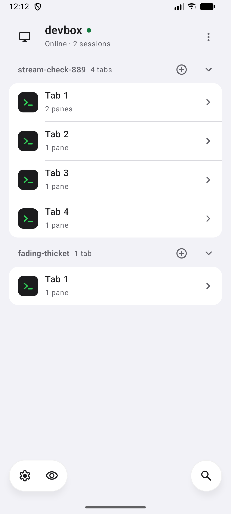
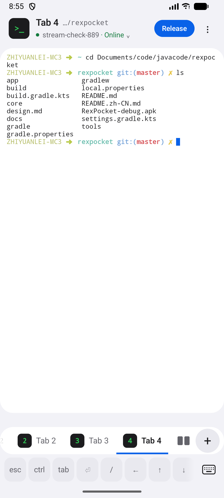
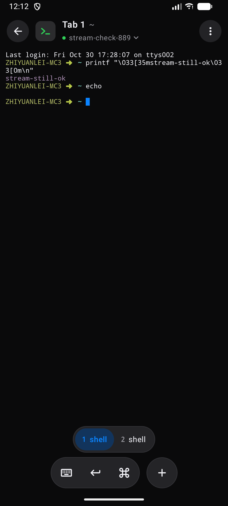

<p align="center">
  <b>English</b> · <a href="README.zh-CN.md">简体中文</a> · <a href="README.zh-TW.md">繁體中文</a>
</p>

# RexPocket

An Android client for [Rex](https://rex.app), the terminal multiplexer. It shows every session on
your own Rex servers, down to the tab, and opens any pane as a full-screen terminal you type into
directly. It talks to your Rex and nothing else - on the local network, or over your tailnet
through a Tailscale node built into the app.

| Home | Terminal | Terminal at night |
| --- | --- | --- |
|  |  |  |

## Features

- **Every host, session and tab on one screen.** Each tab shows what runs in it - pi, Claude,
  Codex, an editor, or a shell - with its own mark and the title its program set, and a blue dot
  while a program in it is working or waiting for you.
- **A real terminal.** The pane is drawn by Ghostty's emulator from Rex's own stream: a snapshot of
  the whole terminal first, then its output as it comes. Colours, scrollback and full-screen
  programs are exactly as on the desk.
- **Made for the phone.** Typing goes straight into the pane. A floating dock holds the keyboard,
  Return and a key row: `esc`, `C-c`, arrows that repeat while held, Tab, `shift` / `ctrl` /
  `alt` for the next key (from the row or the phone keyboard), paste, `/` and copy. Hold `ctrl`
  for `C-c` `C-d` `C-z` `C-r` `C-l` `C-a` `C-e` `C-w` `C-j`. A split shows one pane at a time,
  with a bar to move between them.
- **Links.** Long-press a link a program printed, or one it set as a hyperlink, to open, copy or
  share it.
- **Files and images.** Pick any file on the phone and send it to the pane you are looking at.
  Rex stores it on the computer and types its path itself, so a screenshot can go straight into an
  agent's prompt.
- **Background alerts.** Optional: the app stays connected while it is away and notifies you when a
  program waits for approval, an answer or a login, or fails. Tap the alert to open that pane.
- **Works beside the desk.** The phone holds only the pane it shows and sizes it to the phone; the
  desktop keeps its own tab. **Release** hands a pane back to the desk until you **Take over**.
- **Your tailnet, without the Tailscale app.** The app runs its own Tailscale node, so a host is
  reachable by its MagicDNS name or `100.x` address without taking the phone's VPN slot.
- **Light and dark,** following the phone, in English and Simplified Chinese.

## Set up the computer

Rex has to listen where the phone can reach it.

**On the local network.** Start Rex with a plaintext port:

```sh
rex server start --extra-listen :7297 --allow-anonymous
```

Anyone who can reach that port has full access to that Rex, so open it only on a network you
trust.

**Over a tailnet.** Turn on Rex's built-in Tailscale on the computer; it serves Rex over HTTPS
at its MagicDNS name. Nothing has to be opened on the router.

## Use the app

1. **Add a host.** Settings › Add host. A name and an address is all it takes:
   - `192.0.2.10` - plaintext on port 7297
   - `192.0.2.10:7300` - another port
   - `my-mac.tail1234.ts.net` or a `100.x` address - through Tailscale, on 443 with TLS

   The line under the field shows how the app will connect.
2. **For a tailnet host, join the tailnet.** Settings › Tailscale, give the phone a node name and
   save. The app opens the sign-in page once; after that the node starts with the app.
3. **Open a tab.** Tap a tab on the home screen. The plus beside a session makes a new tab; the
   host's menu starts a new session.
4. **In the terminal:**
   - Tap the pane to type. Drag to scroll back, pinch to change the font size, long-press to
     select, or long-press a link to open it.
   - The command key opens the key row. Tap `shift`, `ctrl` or `alt` for the next key, twice to
     keep it on: `shift` then Return is a new line in an agent's prompt. Hold `ctrl` and slide to a
     chord.
   - Tap the title for the session's tabs and panes, and the list of sessions.
   - Swipe left or right, or use the bar under the pane, to move between the panes of a split.
   - The menu holds Release / Take over, splitting, renaming and closing.
5. **On the home screen,** the eye keeps only the tabs with a program working or waiting, and
   search filters hosts, sessions and tabs.
6. **Background alerts:** Settings › Background alerts, and allow notifications. A quiet
   notification shows while the app watches; its **Stop** turns alerts off. The app does not start
   on its own after a reboot, and Android's battery saving can delay an alert.

## How it works

- **Control.** One WebSocket to `/api/control` (`rex.control.v1`). The app subscribes to Rex's
  events, so a session's tabs, each program's status, its title and the shell's directory arrive
  as they change; nothing is polled. Calls run side by side; typed input has its own queue, so
  keys reach the program in the order they were pressed.
- **The pane.** A second WebSocket to `/api/data` (`rex.data.terminal.v1`) carries a `GHOSTSNP`
  snapshot of the terminal, then its output. A dropped stream resumes from the last byte; an idle
  pane costs no traffic.
- **Ownership.** The phone owns only the pane on its screen, with `session.own_block`, so Rex
  applies the phone's size to it. Moving between tabs and panes is local to the phone: Rex's
  active tab stays the desktop's. When the desktop takes the shown pane, the phone takes it back,
  waiting longer each time the desk insists. A released pane stays the desk's until Take over.
- **Tailscale.** The node is sing-box's Tailscale endpoint behind a SOCKS5 inbound on loopback;
  only the app's own connections use it. The node's UDP is bound to the phone's Wi-Fi or mobile
  network, around a proxy VPN such as Clash when the VPN allows apps to bypass it, so a direct
  path can form. The home screen shows the path to each tailnet host - direct, peer relay or
  DERP - with its round trip; tap it to measure again.

### A faster tailnet path

From mobile data to a computer behind a home router, Tailscale often falls back to a DERP relay
abroad, and every round trip costs a few hundred milliseconds. Either make the computer reachable
(UPnP or NAT-PMP on the router, or a port forward for its Tailscale UDP port), or run your own
DERP server or peer relay close to you and add it to the tailnet. The app follows without a
change.

## Build

Requires JDK 17 and the Android SDK (platform 36).

```sh
./gradlew :core:test :app:assembleDebug
```

The APK lands in `app/build/outputs/apk/debug/`; `:app:assembleRelease` builds one signed with the
debug key. Builds are arm64-v8a only. `app/libs/libbox.aar` (sing-box 1.14.4) is checked in; to
build it for another ABI, run [tools/build-libbox.sh](tools/build-libbox.sh). The integration
tests in `core` run against a Rex on `127.0.0.1:7297` (set `REX_TEST_HOST` / `REX_TEST_PORT`) and
are skipped without one.

## Acknowledgements

- [Rex](https://rex.app), by [Superlogical](https://superlogical.com) - the multiplexer, its API and
  its session model.
- [libghostty-android](https://github.com/SagerNet/libghostty-android), by
  [SagerNet](https://github.com/SagerNet) - the VT bindings and terminal view.
- [Ghostty](https://ghostty.org), by Mitchell Hashimoto and contributors - the terminal emulator.
- [sing-box](https://github.com/SagerNet/sing-box) and its libbox library - the Tailscale node.
- [Material Symbols](https://github.com/google/material-design-icons) (Rounded), by Google, Apache
  License 2.0 - the interface icons. The program marks are the app's own drawings, not the
  products' logos.
