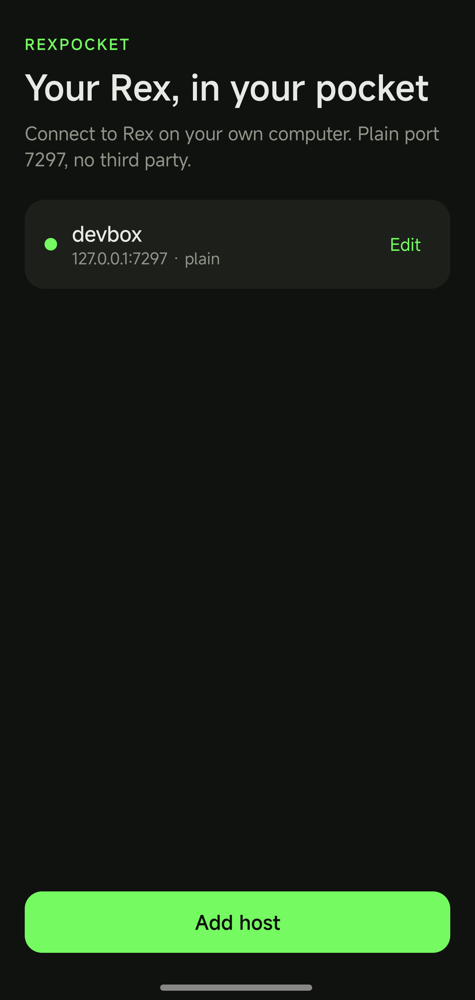
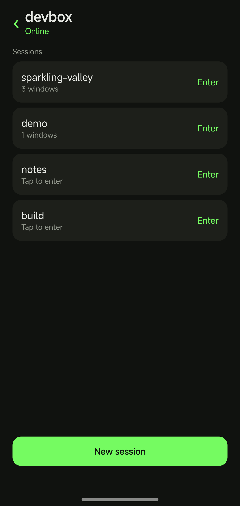
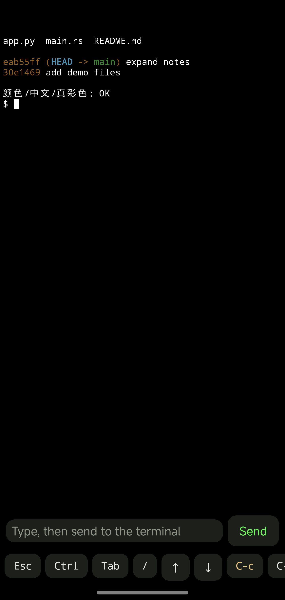

<p align="center">
  <b>English</b> · <a href="README.zh-CN.md">简体中文</a>
</p>

# RexPocket

A Rex client for your phone. The interaction follows [Moshi](https://getmoshi.app/docs/rex): a host list, session picker, tabs and panes in the terminal header, and a toolbar of special keys. It only talks to your own Rex, never through a third party.

The screen is replayed from the server's `com.superlogical.terminal.format` (`vt`) dump, polled roughly every 180 ms while idle and every 30 ms for a moment after input, so a swipe in a full-screen program such as pi, which turns into wheel reports, comes back quickly. That dump is a linear replay of the whole scrollback plus the screen, so rendering is handed to [libghostty-vt](https://github.com/sagernet/libghostty-android): the first dump resets with `RIS` and replays in full, and later polls feed only the appended tail, so the native scroll position is not yanked back to the bottom while you type or read. The pane you are viewing is held with `session.own_block` and sized to the phone; leaving the session or disconnecting `disown`s it so the desktop can take the size back.

Sending a line means writing the text and then pressing Enter as a separate key event. Full-screen TUIs such as pi read a newline inside pasted text as a line break in their own input box, so a newline bundled with the text only breaks the line instead of submitting it.

## Screenshots

| Hosts | Sessions | Terminal |
| --- | --- | --- |
|  |  |  |

## On the computer

Expose a plaintext port only on a network you trust. Anyone who can connect has full access to that Rex.

```sh
rex server start --extra-listen :7297 --allow-anonymous
```

The phone and the computer must share a network, or sit inside your own VPN / Tailscale route, or the app can join your tailnet itself - see [Tailscale](#tailscale). The app uses `ws://host:7297/api/control` with the `rex.control.v1` subprotocol by default.

## On the phone

1. Add a host: a name and an address. `9.134.131.226` is port 7297 over plaintext, `host:7300` picks the port, and a `.ts.net` name or a `100.x` address goes through Tailscale on 443 with TLS; the line under the field shows what the app made of it.
2. The session list is drawn from what this host had last time, so it has content immediately, and the live list replaces it when the connection opens. Tapping a host always lands on the session list. Opening a session goes back to the pane the phone showed there last time. The first time, or when that pane is gone, it shows the tab and pane Rex has focused, the same place the desktop is on.
3. Session → tab → pane. Rex calls a tab a window. Under the header, the tab bar lists the session's tabs: tap one to switch, and Rex brings back the pane that tab last had focused. A tab holding several panes shows their count, and below it a pane strip lists them by number. The phone draws only one pane at a time, so a desktop split shows up as chips here rather than side by side. `+` on either row adds a tab or a pane. Long-press a tab or pane chip for a sheet to rename or close it; closing asks first.
4. Terminal: drag down to read scrollback, and the arrow at the bottom right returns to following the output. Pinch to change the font size, long-press to select and then tap `Copy` in the toolbar.
5. Toolbar: `Esc`, `Ctrl` (double-tap to lock), `Tab`, `⏎`, `/`, arrows, `C-c` `C-d` `C-z` `C-l`, paste and copy.
6. The composer writes into the terminal. `Send`, or the keyboard's own send key, writes the text and then presses Enter; with the box empty it presses Enter alone, which is how a full-screen program such as pi confirms the item its menu has selected. Long-press `Send` to send Enter without the text.
7. `Esc`, `Tab`, the arrows, `⏎` and `/` are keys for the program in the pane, so `/` opens pi's command menu and the arrows walk it. Typing a command such as `/model` in the composer and sending it lands the text in pi, where the menu takes the Enter that follows the text to accept the completed command, so tap `⏎` to run it.
8. `Sessions` opens a list of the sessions on this Rex; tap one to switch to it. `···` opens a sheet of actions grouped by level: pane, tab, session. While a program is working or waiting for you the header shows `Stop`, which sends `Ctrl-C`.

## Tailscale

The app can join your tailnet itself, so a host there is reachable by its MagicDNS name (`host.tailnet-xxxx.ts.net`) or its `100.x` address without the Tailscale app and without taking the phone's one VPN slot. The node runs inside the app (sing-box's Tailscale endpoint): only the connections this app opens for Rex go through it, the rest of the phone is untouched.

1. The `Tailscale` row on the home screen asks for this phone's node name; saving joins the tailnet: the app starts its node and, when it has never been authorized, opens the authorization page in a browser by itself. The login stays in the app, so this happens once.
2. A host is just an address: `192.0.2.10`, `host:7300` or `wss://host:443`. The port, plaintext or TLS, and whether the host goes through Tailscale all follow from it - a `.ts.net` name or a `100.x` address goes through the node (443 + TLS by default), anything else is 7297 plaintext, and the line under the field shows what the app worked out.
3. An address on a tailnet while the phone has not joined yet shows a note in the dialog: the host is saved anyway, and tapping the note joins right there.
4. A tailnet connection is dialed through a SOCKS5 inbound on loopback that sing-box routes into the tailnet, so a MagicDNS name is resolved by Tailscale and a `100.x` address is dialed by it. The node stays `Running` while the app runs.

The library is arm64-v8a only: `app/libs/libbox.aar`, ~57 MB unpacked, built from sing-box 1.14.4 by [tools/build-libbox.sh](tools/build-libbox.sh). Rebuild it for another ABI, or with other protocol tags, if you need them.

## Languages

The UI ships in English and Simplified Chinese. English is the default (`values/`), Chinese lives in `values-zh/`, so an English device starts in English and a Chinese device starts in Chinese. Per-app language selection works on Android 13 and later.

## Build

Requires Android SDK 36 and JDK 17.

```sh
./gradlew :core:test :app:assembleDebug
```

`app/libs/libbox.aar` ships with the repository (see [Tailscale](#tailscale)), so a plain checkout builds without any extra toolchain.

The debug APK lands in `app/build/outputs/apk/debug/app-debug.apk`.
