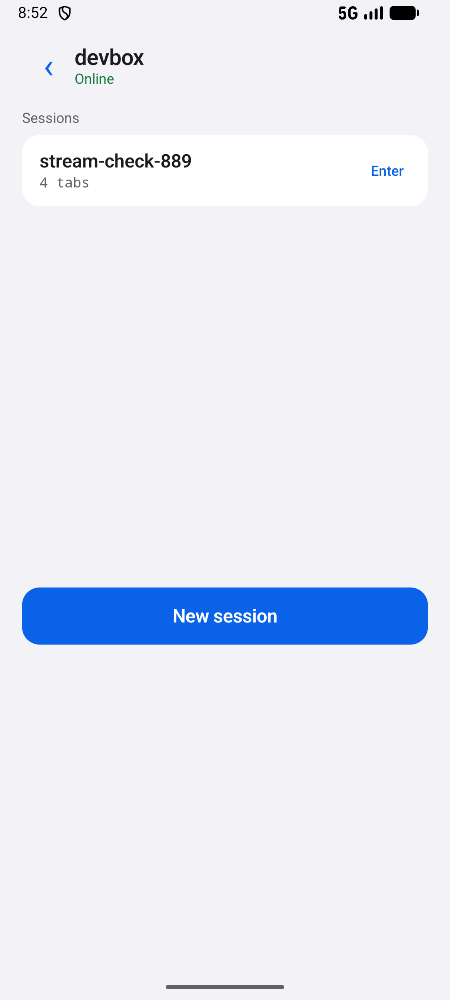

<p align="center">
  <b>English</b> · <a href="README.zh-CN.md">简体中文</a>
</p>

# RexPocket

A Rex client for your phone: a host list, a session picker, and a terminal with one dock at the foot - the tabs of the session, the keys a phone keyboard lacks, and the switch that hands the pane between the phone and the desk. It only talks to your own Rex, never through a third party.

- **The screen is streamed, not polled.** Rex serves the pane over `/api/data` (`rex.data.terminal.v1`): the stream opens with a `GHOSTSNP` snapshot of the whole terminal - scrollback, colours, cursor, and the escape sequence the program is in the middle of - then carries its output as it comes. An idle pane costs nothing; the phone measured 2 CPU ticks and 0.3 KB per 20 seconds, where polling cost 107 ticks and 500 KB. [libghostty-vt](https://github.com/sagernet/libghostty-android) restores the snapshot and is fed the rest in order, so a reconnect shows the pane as it is, not a replayed history.
- **What you type arrives in order.** Typing in the pane, the keys in the dock and a paste all go out through one queue; Rex only orders some of its methods, so they are sent one at a time, each after the reply to the one before.
- **The app is quiet in the background.** Nothing is polled while it is not on screen, and the connection stays open.
- **It says what went wrong, in words.** Unreachable, no answer, dropped, refused by Rex, tailnet not joined: each has its own line, with **Retry now** on both screens. A change of network redials at once.
- **The pane is yours while you look at it.** It is held with `session.own_block` and sized to the phone. If the desktop takes it back - Rex does that when its own window is focused - the app takes it back within a few seconds and reapplies the phone's size, so the pane is never drawn at the desktop's width with its right side cut off. The header says which way that is: **Release** (filled) while the phone holds the pane, **Take over** (outlined) once it has been handed back, and a release is not undone by the take-back loop, and it belongs to the pane: moving to another tab and back does not take it - the pane stays the desk's until you take it again.

## Screenshots

| Hosts | Sessions | Terminal |
| --- | --- | --- |
|  |  |  |

## On the computer

Expose a plaintext port only on a network you trust. Anyone who can connect has full access to that Rex.

```sh
rex server start --extra-listen :7297 --allow-anonymous
```

The phone and the computer must share a network, or sit inside your own VPN / Tailscale route, or the app can join your tailnet itself - see [Tailscale](#tailscale). The control connection is `ws://host:7297/api/control` with the `rex.control.v1` subprotocol, and the pane's stream is `/api/data` on the same host.

## On the phone

1. **Hosts.** A host is a name and an address. `192.0.2.10` is port 7297 over plaintext, `host:7300` picks the port, and a `.ts.net` name or a `100.x` address goes through Tailscale on 443 with TLS; the line under the field shows what the app made of it. Save is disabled until the address says where to connect, deleting a host asks first, and the `Tailscale` row above the list is where the phone's own node is joined.
2. **Sessions.** The list is drawn from what this host had last time, so it has content immediately, and the live list replaces it when the connection opens. A tap while the connection is still coming up waits for it and says *Opening*. New session waits for Rex to create it before switching, so the typing never lands in the session you were leaving. Opening a session goes back to the pane the phone showed there last time; the first time, or when that pane is gone, it shows the tab and pane Rex has focused, the same place the desktop is on.
3. **The dock: tabs, keys, control.** Under the terminal sits the tab row of the session - one tile and name per tab, the shown tab marked by a rule under its name - with the layout button and `+` beside it. Tap a tab to switch, and Rex brings back the pane that tab last had focused; a tab holding several panes shows their count. `+` makes a tab. The layout button opens **Tabs and panes**, where a tab is picked, a pane is picked by number, and new tabs and splits are made. Long-press a tab for rename and close; closing asks first. The header above the pane names the tab and its directory, and the line under it - session, state, chevron - opens the session list.
4. **The terminal.** Typing goes straight into the pane, as it does on a desk terminal: tap the screen to raise the keyboard, and the key row stays above it. Drag to read scrollback; pinch to change the font size; long-press to select and then tap `Copy` in the key row. Until Rex sends the pane's first snapshot the area says *Reading the screen…*, and offers Retry if it takes long - a pane with a long history arrives as several megabytes.
5. **Panes on a phone.** The phone draws one pane at a time, so a desktop split becomes a pager: a blue bar for the pane you are on and a dot for each other pane, under the terminal. Tap a dot, or swipe the pane left and right, to move between them. Swiping is the only gesture read on the pane; scrolling and selection are the terminal's.
6. **The keys.** `esc`, `ctrl` (double-tap to lock), `tab`, `⏎`, `/`, the arrows, `C-c`, `C-d`, `C-z`, `C-l`, paste, copy and the arrow pad, in one row that scrolls; the keyboard key waits at its right end, outside the scroll, and raises or drops the IME. `esc`, `tab`, the arrows, `⏎` and `/` are keys for the program in the pane, so `/` opens pi's command menu and the arrows walk it. While a program is working or waiting for you, `C-c` is named `Stop` and turns red. `ctrl` applies to the next key pressed in the row.
7. **The menus.** Tapping the session line opens the session list; `⋮` opens a sheet of actions grouped by level - pane, tab, session - and the way back to **Hosts**. The system back gesture goes to the session list as well.

## Tailscale

The app can join your tailnet itself, so a host there is reachable by its MagicDNS name (`host.tailnet-xxxx.ts.net`) or its `100.x` address without the Tailscale app and without taking the phone's one VPN slot. The node runs inside the app (sing-box's Tailscale endpoint): only the connections this app opens for Rex go through it, the rest of the phone is untouched.

1. The `Tailscale` row on the home screen asks for this phone's node name; saving joins the tailnet: the app starts its node and, when it has never been authorized, opens the authorization page in a browser by itself. The login stays in the app, so this happens once.
2. The row says what the node is doing: starting, running, login needed, waiting for approval, or failed - with the reason one tap away. A start that fails on libbox's cache file - which a process killed mid-run can leave behind - drops that cache and tries once more, so the node does not stay down until the app's data is cleared.
3. A tailnet connection is dialed through a SOCKS5 inbound on loopback that sing-box routes into the tailnet, so a MagicDNS name is resolved by Tailscale and a `100.x` address is dialed by it. The same route carries the pane's stream as well as the control connection.
4. **The node's UDP goes around a VPN on the phone.** A proxy VPN, such as Clash, would otherwise carry the node's WireGuard and hole-punching packets too: the node then sees the proxy's address as its own, a direct path cannot form, and handshakes through the proxy stall until the pane never arrives. So the node binds its UDP sockets to the phone's own network (Wi-Fi or mobile data), and leaves its TCP - to the control plane and to DERP - on the default route, where a blocked `tailscale.com` is reached through the proxy. Android allows this only when the VPN lets apps bypass it; Clash does. These packets are then outside the VPN's rules.
5. **The path is shown.** For a host on the tailnet, the line under its name on the session list says how the phone reaches it - `direct`, `through a peer relay`, or `relayed by DERP sfo` - with the round trip in milliseconds; tap it to measure again. On the same Wi-Fi it is direct. From mobile data to a computer behind a home router it is usually a DERP relay abroad, a few hundred milliseconds away, and the first picture of a pane takes several seconds.
6. **Making it direct is the network's business.** The computer's node has to be reachable from outside: UPnP or NAT-PMP on the home router, or a port forward for its Tailscale UDP port, lets the phone punch through. Failing that, a DERP server or a peer relay in the same country brings the relay from abroad to tens of milliseconds; both are set up in the tailnet, and the app follows without a change.

The library is arm64-v8a only: `app/libs/libbox.aar`, ~57 MB unpacked, built from sing-box 1.14.4 by [tools/build-libbox.sh](tools/build-libbox.sh). Rebuild it for another ABI, or with other protocol tags, if you need them.

## Acknowledgements

The interface follows the phone terminal design in [Shulhi Sapli](https://github.com/shulhi)'s Rex demo - the light paper, the dark terminal tile, the control pill, the tab dock and the key row. The design is his; this is an independent implementation of the interactions he laid out.

- [Rex](https://rex.app), by [Superlogical](https://superlogical.com), is the multiplexer this client talks to: its RPC, its session model and its pane ownership are the whole reason this app exists.
- [libghostty-android](https://github.com/SagerNet/libghostty-android), by [SagerNet](https://github.com/SagerNet), provides the VT bindings and the terminal components the pane is drawn with.
- [Ghostty](https://ghostty.org) ([ghostty-org/ghostty](https://github.com/ghostty-org/ghostty)), by Mitchell Hashimoto and its contributors, is the terminal emulator underneath.
- [sing-box](https://github.com/SagerNet/sing-box) and its [libbox](https://github.com/SagerNet/sing-box/tree/dev/platform) Android library carry the Tailscale node the app runs for hosts on a tailnet.

## Languages

The UI ships in English and Simplified Chinese. English is the default (`values/`), Chinese lives in `values-zh/`, so an English device starts in English and a Chinese device starts in Chinese. Per-app language selection works on Android 13 and later.

## Build

Requires Android SDK 36 and JDK 17.

```sh
./gradlew :core:test :app:assembleDebug
```

`app/libs/libbox.aar` ships with the repository (see [Tailscale](#tailscale)), and the terminal's emulator, `libghostty-android`, comes from Maven Central, so a plain checkout builds without any further toolchain.

The debug APK lands in `app/build/outputs/apk/debug/app-debug.apk`; `:app:assembleRelease` writes one signed with the debug key, for personal builds. Both are arm64-v8a only, and the application id is `me.leaver.rexpocket` - a phone that has the older `app.rexpocket` keeps it as a separate app, with its own hosts and its own tailnet login.
