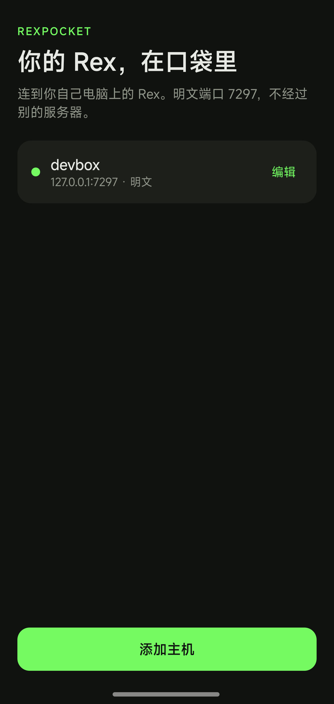
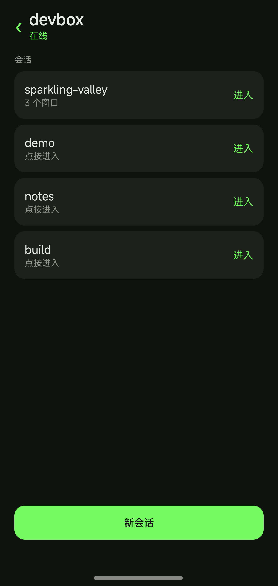
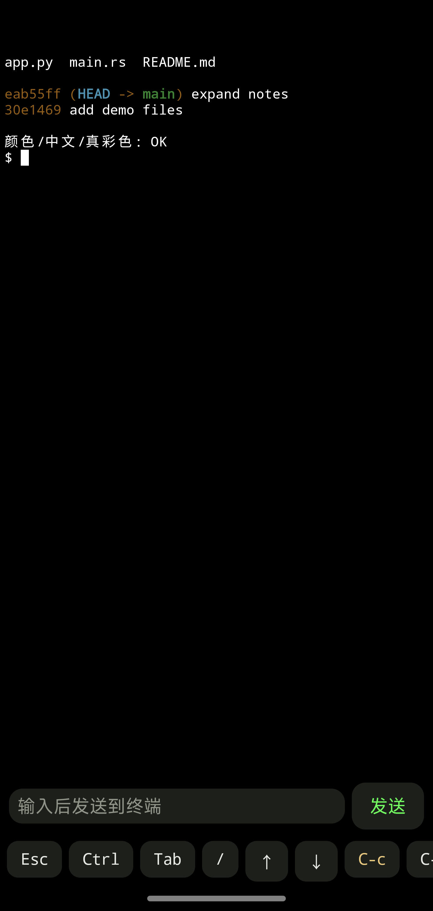

<p align="center">
  <a href="README.md">English</a> · <b>简体中文</b>
</p>

# RexPocket

手机上的 Rex 客户端。交互参照 [Moshi](https://getmoshi.app/docs/rex)：主机列表、会话选择、终端顶部的标签页和窗格、底栏特殊键。只连你自己的 Rex，不经过第三方。

屏幕内容用服务器文档里的 `com.superlogical.terminal.format`（`vt`）重放，空闲时大约每 180ms 拉一次，有输入后的一小段时间里每 30ms 拉一次。pi 这类全屏程序把滑动变成滚轮事件，滚动后的画面要靠这个轮询带回来，所以输入后要拉得更勤。转储是整个回滚加屏幕的线性重放，所以渲染交给 [libghostty-vt](https://github.com/sagernet/libghostty-android)：第一次到达时先 `RIS` 再整份回放，之后的刷新只把新增的尾部喂进去，这样打字或输出时原生滚动位置不会被顶回底部。正在查看的窗格会被 `session.own_block` 占住，尺寸跟手机走；离开会话或断开后会 `disown`，桌面端可以拿回尺寸。

发送一行是「写文字」再加一次独立的回车按键，不把换行拼进粘贴内容里。pi 这类全屏 TUI 会把粘贴内容里的换行当成自己输入框的换行，所以拼在一起只换行不提交。

## 截图

| 主机 | 会话 | 终端 |
| --- | --- | --- |
|  |  |  |

## 电脑上

只在你信任的网络上开明文端口。连上的人拥有这台 Rex 的全部权限。

```sh
rex server start --extra-listen :7297 --allow-anonymous
```

手机和电脑要在同一网络、你自己的 VPN / Tailscale 路由里，或者让应用自己加入 tailnet（见 [Tailscale](#tailscale)）。应用默认 `ws://主机:7297/api/control`，子协议 `rex.control.v1`。

## 手机上

1. 添加主机：名称、IP 或域名、端口 `7297`、明文打开。
2. 点主机后总是先进会话列表。进入会话时回到手机上次在这个会话里看的窗格；第一次进入或那个窗格已经关掉时，显示 Rex 当前聚焦的标签页和窗格，和桌面端停在同一处。
3. 会话 → 标签页 → 窗格。Rex 里的 window 就是标签页。顶栏下面的标签栏列出会话的所有标签页，点一下就切换，Rex 会回到这个标签页上次聚焦的窗格。有多个窗格的标签页会标出数量，下面一行窗格条按编号列出这些窗格。手机任何时刻只画一个窗格，所以桌面上的分屏在这里是一排编号，不会并排显示。两行末尾的「+」分别新建标签页和窗格。长按标签或窗格会从底部弹出操作，可以重命名或关闭，关闭前会确认。
4. 终端：向下拖看回滚，右下角的箭头回到跟随输出；双指捏合改字号，长按选词后点底栏「复制」。
5. 底栏：`Esc`、`Ctrl`（双击锁定）、`Tab`、`⏎`、`/`、方向键、`C-c` `C-d` `C-z` `C-l`、粘贴和复制。
6. 输入框把文字写进终端。点「发送」或键盘自己的发送键，都是先写文字再按一次回车；输入框为空时只按回车，pi 这类全屏程序就靠这个回车确认它菜单里选中项。长按「发送」只发回车，不发文字。
7. `Esc`、`Tab`、方向键、`⏎` 和 `/` 发给窗格里跑的程序，所以 `/` 能打开 pi 的命令菜单、方向键能在菜单里走。在输入框里打 `/model` 再发送，文字会进到 pi 里，但紧随其后的那个回车被命令菜单吃掉，只用来补全候选，所以再点一下 `⏎` 才真正执行。
8. 「会话」列出这台 Rex 上的所有会话，点一下就切过去。「···」从底部弹出操作，按窗格 / 标签页 / 会话分组。进行中或等待你时，顶栏有「停」，发送 `Ctrl-C`。

## Tailscale

应用可以自己加入 tailnet：tailnet 里的主机用 MagicDNS 名字（`host.tailnet-xxxx.ts.net`）或 `100.x` 地址就能连，不用装 Tailscale 应用，也不占手机唯一的 VPN 位。节点跑在应用里（sing-box 的 Tailscale 端点），只有本应用连 Rex 的流量走它，手机其余流量不受影响。

1. 首页的 `Tailscale`：打开开关并保存。可以粘 Tailscale 管理后台（`Settings → Keys`）生成的认证密钥（可重复使用、已授权的密钥比较省事），也可以留空，改用链接授权这个节点。
2. 编辑主机并打开「走 Tailscale」。这条连接就交给回环地址上的 SOCKS5 入站，由 sing-box 路由进 tailnet：名字由 MagicDNS 解析，`100.x` 地址由 Tailscale 拨号。
3. 第一次连接会启动节点。还需要登录时，会话列表上有一条提示：点一下复制登录链接，在浏览器里授权这个节点再回来，正在重试的连接就会接上。登录状态会留着，只有这一次。
4. 首页那一行和 `Tailscale` 设置里显示节点状态（`启动中`、`需要登录`、`运行中`）以及 tailnet 看到的节点名；节点名留空时用设备型号，失败时退回 `rexpocket`。回到主机列表会停掉节点。

库只有 arm64-v8a：`app/libs/libbox.aar`，解包后约 57 MB，由 sing-box 1.14.4 用 [tools/build-libbox.sh](tools/build-libbox.sh) 构建。要别的 ABI 或别的协议集，改脚本重编。

## 语言

界面提供英文和简体中文。英文是默认语言（`values/`），中文在 `values-zh/`，所以英文系统启动就是英文，中文系统启动就是中文。Android 13 及以上支持单独切换应用语言。

## 构建

需要 Android SDK 36 和 JDK 17。

```sh
./gradlew :core:test :app:assembleDebug
```

`app/libs/libbox.aar` 已随仓库提供（见 [Tailscale](#tailscale)），不需要单独构建。

调试包在 `app/build/outputs/apk/debug/app-debug.apk`。
