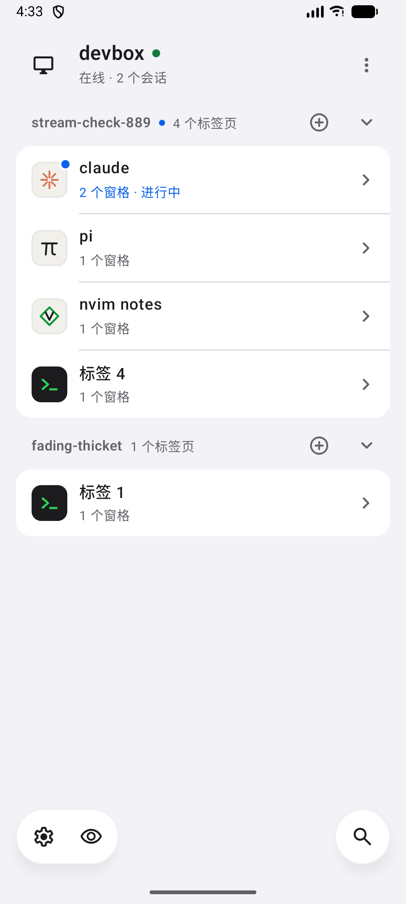
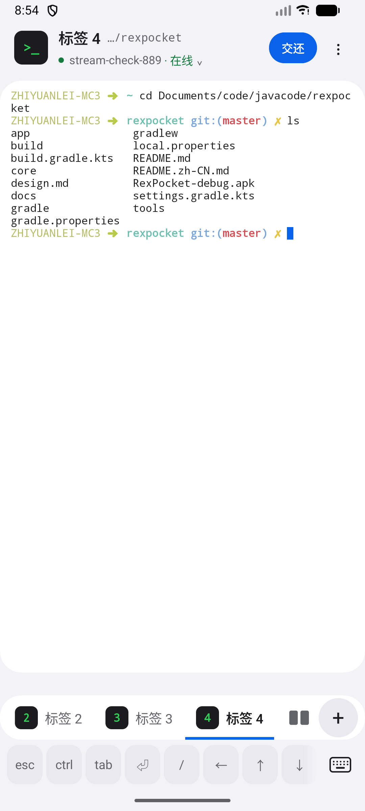
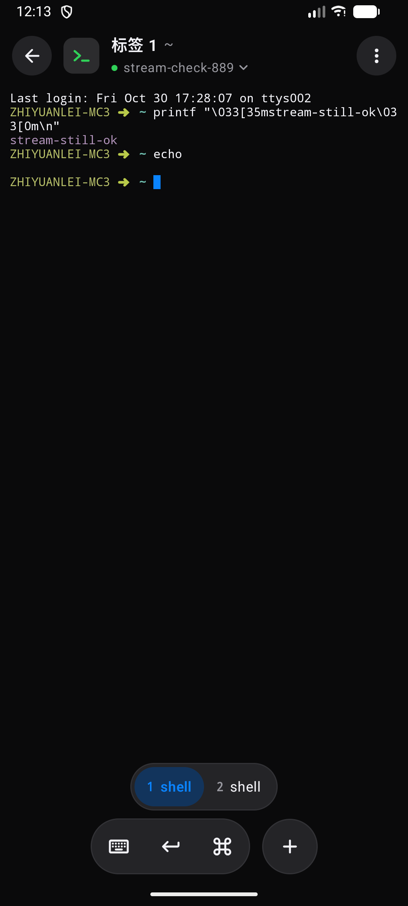

<p align="center">
  <a href="README.md">English</a> · <b>简体中文</b>
</p>

# RexPocket

终端多路复用器 [Rex](https://rex.app) 的 Android 客户端。它把你自己的 Rex 服务器上的所有会话一直列到标签页，
点开任意窗格就是一个全屏终端，直接输入。它只和你的 Rex 通信，不经过任何第三方——可以走局域网，
也可以通过 App 内置的 Tailscale 节点走你的 tailnet。

| 主页 | 终端 | 夜间终端 |
| --- | --- | --- |
|  |  |  |

## 功能

- **所有主机、会话、标签页都在一个页面。** 每个标签页显示里面跑的是什么——pi、Claude、Codex、编辑器
  还是 shell——配上各自的图标和程序设置的标题；有程序在运行或在等你时，图标上会有一个蓝点。
- **真正的终端。** 窗格由 Ghostty 的终端模拟器绘制，数据来自 Rex 自己的流：先是整个终端的快照，
  之后是实时输出。颜色、回滚历史、全屏程序都和桌面上一模一样。
- **为手机设计。** 输入直接进窗格。底部浮动的 dock 里有键盘、回车，以及一个按键面板，里面有 `esc`、
  `ctrl`、Tab、方向键、`C-c` 和粘贴。分屏一次显示一个窗格，用下方的切换条在窗格之间切换。
- **和桌面同时用。** 手机只占它正在显示的那个窗格，并按手机尺寸显示；桌面停在它自己的标签页上。
  **交还** 把窗格还给桌面，直到你再 **接管**。
- **不装 Tailscale 也能上 tailnet。** App 自带一个 Tailscale 节点，用 MagicDNS 名字或 `100.x` 地址
  就能连到主机，也不占手机唯一的 VPN 位置。
- **浅色与深色**跟随手机，支持英文和简体中文。

## 电脑端设置

Rex 要监听在手机能访问到的地方。

**局域网。** 用明文端口启动 Rex：

```sh
rex server start --extra-listen :7297 --allow-anonymous
```

能访问这个端口的人就能完全控制这个 Rex，所以只在你信任的网络里打开它。

**tailnet。** 在电脑上打开 Rex 内置的 Tailscale，它会用自己的 MagicDNS 名字通过 HTTPS 提供 Rex，
路由器上什么都不用开。

## 使用

1. **添加主机。** 设置 › 添加主机，填名字和地址就行：
   - `192.0.2.10`——明文，7297 端口
   - `192.0.2.10:7300`——换个端口
   - `my-mac.tail1234.ts.net` 或 `100.x` 地址——走 Tailscale，443 端口，TLS

   输入框下面那行会显示 App 打算怎么连。
2. **tailnet 主机要先加入 tailnet。** 设置 › Tailscale，给手机起一个节点名并保存。App 会打开一次
   登录页，之后节点随 App 启动。
3. **打开标签页。** 在主页点一个标签页。会话旁边的加号新建标签页，主机的菜单里可以新建会话。
4. **终端里：**
   - 点窗格开始输入。拖动查看回滚，双指缩放改字号，长按选中。
   - 点标题查看当前会话的标签页和窗格，以及会话列表。
   - 左右滑动，或用窗格下方的切换条，在分屏的窗格之间切换。
   - 菜单里有交还 / 接管、分屏、重命名和关闭。
5. **主页上，** 眼睛按钮只保留有程序在运行或在等你的标签页；搜索可以过滤主机、会话和标签页。

## 工作原理

- **控制连接。** 一条 WebSocket 连 `/api/control`（`rex.control.v1`）。App 订阅 Rex 的事件，会话的
  标签页、每个程序的状态、标题和 shell 所在目录都在变化时推送过来，不做任何轮询。请求并行发送；
  键盘输入单独排一个队，按下的键会按顺序到达程序。
- **窗格。** 第二条 WebSocket 连 `/api/data`（`rex.data.terminal.v1`），先传终端的 `GHOSTSNP` 快照，
  再传输出。流断开后从最后一个字节续传；空闲的窗格不产生流量。
- **窗格归属。** 手机只用 `session.own_block` 占住屏幕上的那个窗格，于是 Rex 按手机的尺寸显示它。
  在标签页和窗格之间切换只发生在手机上，Rex 的当前标签页仍然归桌面。桌面抢走正在显示的窗格时，
  手机会再抢回来，桌面坚持得越久，手机等得越久。交还的窗格一直归桌面，直到你接管。
- **Tailscale。** 节点是 sing-box 的 Tailscale endpoint，前面是回环地址上的 SOCKS5 入口，只有 App
  自己的连接走它。节点的 UDP 绑定在手机的 Wi-Fi 或移动网络上，在 VPN 允许 App 绕过时会绕开 Clash
  这类代理 VPN，这样才能打通直连。主页会显示到每台 tailnet 主机的路径——直连、peer relay 还是
  DERP——以及往返延迟，点一下可以重新测量。

### 让 tailnet 更快

从移动网络连到家里路由器后面的电脑时，Tailscale 常常退回到国外的 DERP 中转，每次往返要几百毫秒。
要么让电脑能被直接访问（路由器开 UPnP 或 NAT-PMP，或者给它的 Tailscale UDP 端口做端口映射），
要么在离你近的地方自建一个 DERP 服务器或 peer relay 并加进 tailnet。App 不需要任何改动。

## 构建

需要 JDK 17 和 Android SDK（platform 36）。

```sh
./gradlew :core:test :app:assembleDebug
```

APK 在 `app/build/outputs/apk/debug/`；`:app:assembleRelease` 会构建一个用调试密钥签名的版本。只构建
arm64-v8a。`app/libs/libbox.aar`（sing-box 1.14.4）已经放在仓库里；要构建其他 ABI，运行
[tools/build-libbox.sh](tools/build-libbox.sh)。`core` 里的集成测试连接 `127.0.0.1:7297` 上的 Rex
（可用 `REX_TEST_HOST` / `REX_TEST_PORT` 修改），没有 Rex 时会跳过。

## 致谢

- [Rex](https://rex.app)，由 [Superlogical](https://superlogical.com) 开发——多路复用器本身、它的 API
  和会话模型。
- [libghostty-android](https://github.com/SagerNet/libghostty-android)，由
  [SagerNet](https://github.com/SagerNet) 开发——VT 绑定和终端视图。
- [Ghostty](https://ghostty.org)，由 Mitchell Hashimoto 及贡献者开发——终端模拟器。
- [sing-box](https://github.com/SagerNet/sing-box) 及其 libbox 库——Tailscale 节点。
- [Material Symbols](https://github.com/google/material-design-icons)（Rounded），Google，Apache
  License 2.0——界面图标。程序图标是 App 自己画的，不是各产品的 logo。
