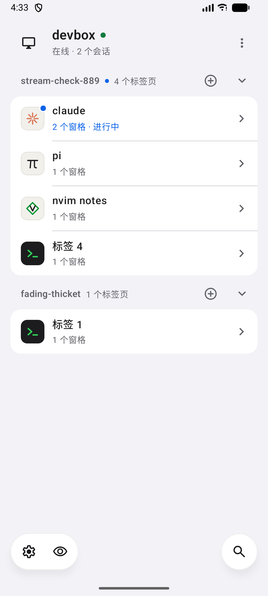
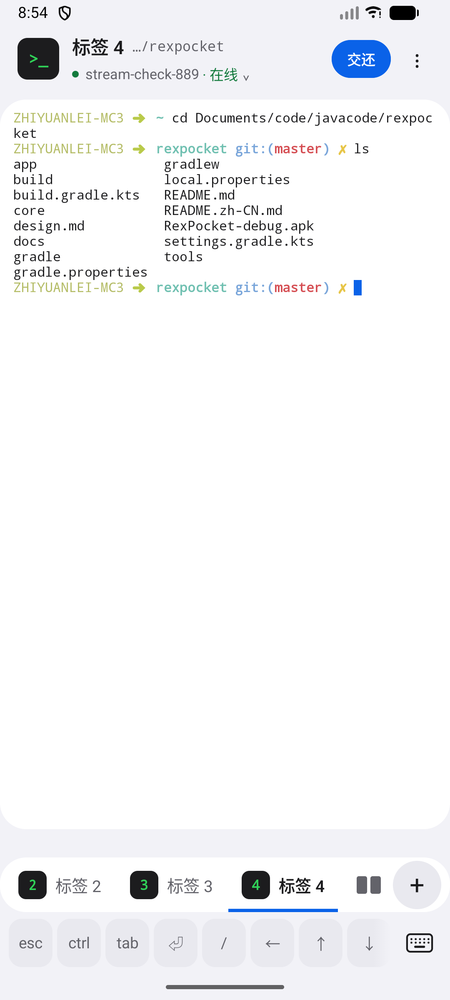
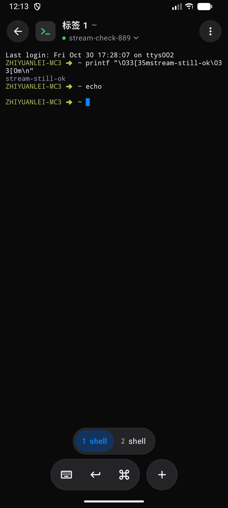
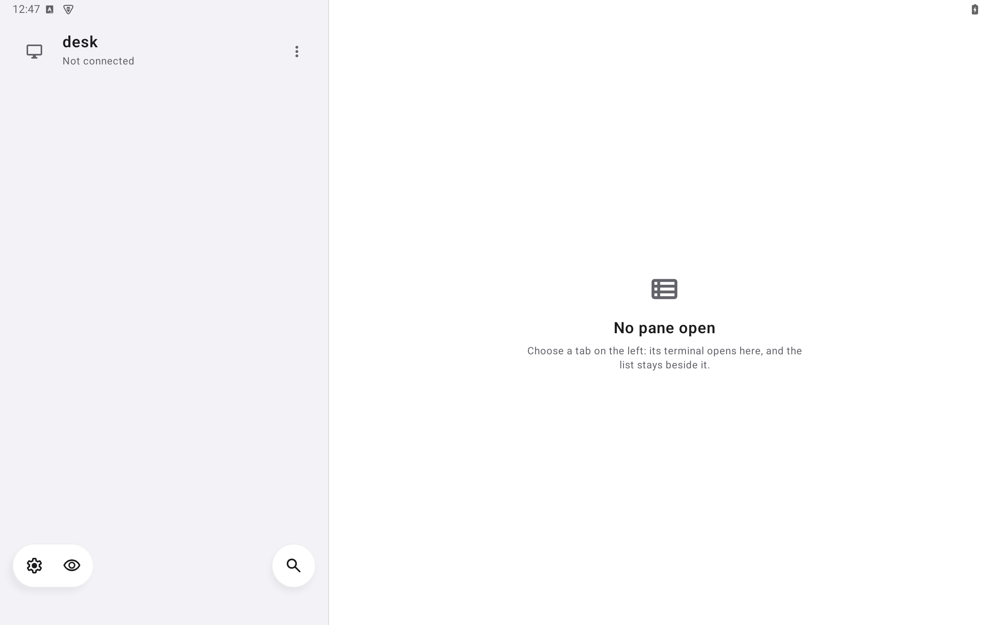
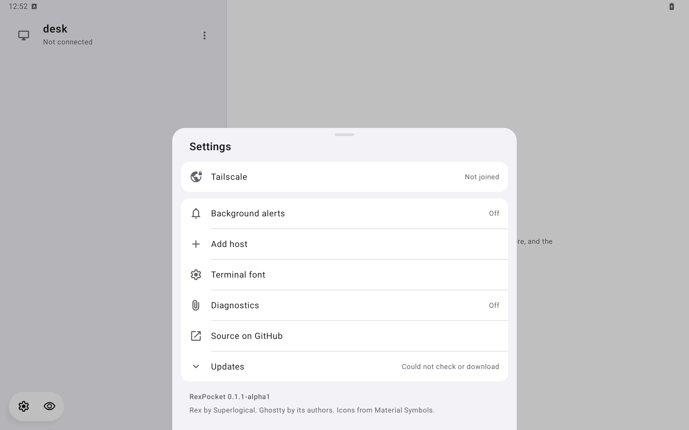

<p align="center">
  <a href="README.md">English</a> · <b>简体中文</b> · <a href="README.zh-TW.md">繁體中文</a>
</p>

# RexPocket

终端多路复用器 [Rex](https://rex.app) 的 Android 客户端。它把你自己的 Rex 服务器上的所有会话一直列到标签页，
点开任意窗格就是一个全屏终端，直接输入。它只和你的 Rex 通信，不经过任何第三方——可以走局域网、
通过 App 内置的 Tailscale 或 Netbird 节点走你的 tailnet，或者走电脑自己的 SSH 服务。

| 主页 | 终端 | 夜间终端 |
| --- | --- | --- |
|  |  |  |

在平板或桌面窗口里，列表常驻在打开的窗格旁边——切换会话或标签页不必离开正在看的终端，底部的按键栏也只是一手可及的宽度。

| 平板：列表与窗格并排 | 平板：设置面板 |
| --- | --- |
|  |  |

## 功能

- **所有主机、会话、标签页都在一个页面。** 每个标签页显示里面跑的是什么——pi、Claude、Codex、编辑器
  还是 shell——配上各自的图标和程序设置的标题；有程序在运行或在等你时，图标上会有一个蓝点。
- **真正的终端。** 窗格由 Ghostty 的终端模拟器绘制，数据来自 Rex 自己的流：先是整个终端的快照，
  之后是实时输出。颜色、回滚历史、全屏程序都和桌面上一模一样。
- **为手机设计。** 输入直接进窗格。底部浮动的 dock 里有键盘、回车和一排快捷键：`esc`、`C-c`、按住会连发的
  方向键、Tab、对下一个键生效的 `ctrl`（Shift / Alt 默认隐藏）（快捷键和手机键盘都适用）、粘贴、回形针和 `/`。
  `Fn` 会固定一块面板：Home、End、PgUp、PgDn、Ins、Del、F1-F12 和常用符号，按键栏上的修饰键对它们同样有效。
  设置 → 终端操作 → 排列按键可以任意调整两组按键的顺序、添加和移除按键——`Fn` 里的任何键（比如 F10）都能直接放到
  按键栏上，单独的方向键、`C-d` 这类组合键、字母和符号也可以——并决定 `Fn` 里放什么。**按键组**是和 `Fn` 一样
  有自己按键的面板：可以新建空组，或从预设（htop、vim、tmux）创建。只有键盘键始终保留；`C-c` 键可以设为程序空闲时
  需要长按（`ctrl` 再按 `c` 始终可以发送）。
  按住 `ctrl` 可选 `C-c` `C-d` `C-z` `C-r` `C-l` `C-a` `C-e` `C-w` `C-j`。分屏一次显示一个窗格，
  用下方的切换条在窗格之间切换。**弹出键盘不会改变终端尺寸**——窗格按键盘盖住的高度往上挪，正在输入的那一行
  留在视野里，里面的程序不会因为键盘进出而重画；**接上实体键盘时 dock 会收起**，因为那些键它本来就有，粘贴、
  发送文件、键盘和全屏仍在菜单里。
- **链接。** 长按程序输出的链接（包括程序设置的超链接），可以打开、复制或分享。
- **文件和图片。** 从手机选择任意文件，发送到正在看的窗格。Rex 把文件存在电脑上，并自己输入它的路径，所以截图可以直接送进 Agent 的提示词。
- **后台提醒。** 可选：App 在后台时保持连接，程序等你批准、回答、登录或出错时发通知，点通知直接打开那个窗格。
- **和桌面同时用。** 手机只占它正在显示的那个窗格，并按手机尺寸显示；桌面停在它自己的标签页上。
  **交还** 把窗格还给桌面，直到你再 **接管**。
- **不装 Tailscale 或 Netbird 也能上 tailnet。** App 自带一个 Tailscale 或 Netbird 节点，用 MagicDNS
  名字或 `100.x` 地址就能连到主机，也不占手机唯一的 VPN 位置。
- **通过 SSH 添加主机。** 填 `ssh://host`，再填账号和密码（或私钥），就能通过机器本来就在跑的 SSH 服务
  连到 Rex，不用对外开放 Rex 端口。第一次连接会显示并记住主机密钥；密钥变了会停下，等你确认。
  tailnet 地址仍然走 App 内置的节点。
- **知道自己旧了。** 每天启动时（以及点设置 › 更新时）去 GitHub releases 查有没有新版本，有就提示；
  你不点就不下载，安装前 Android 只会问一次权限。更新通道决定什么算新版本：**稳定**只收正式版，**尝鲜**收
  最新发布的构建，alpha 和 beta 也算；没选过的安装跟着自己来源那条通道走。
- **浅色与深色**跟随手机，支持英文和简体中文。

## 电脑端设置

Rex 要能从手机访问到：局域网、tailnet，或者 SSH 都可以。

**局域网。** 用明文端口启动 Rex：

```sh
rex server start --extra-listen :7297 --allow-anonymous
```

能访问这个端口的人就能完全控制这个 Rex，所以只在你信任的网络里打开它。

**tailnet。** 在电脑上打开 Rex 内置的 Tailscale，它会用自己的 MagicDNS 名字通过 HTTPS 提供 Rex，
路由器上什么都不用开。

**SSH。** 在电脑上装好 Rex（`rex server install` 就会装好），让非交互登录也能运行 `rex`
（App 也会去 `~/.local/bin`、`/usr/local/bin` 和 `/usr/bin` 找）。非交互的 SSH 登录不会读交互式 shell 的 PATH，所以在 macOS 上 Rex 装在 App 包里，要把它链接到上面某个目录，例如 `ln -s "<Rex App>/Contents/MacOS/rex" ~/.local/bin/rex`，指向包里的 `Versions/Current`，这样更新后仍然有效。路由器上什么都不用开：App 通过机器自己的 SSH 服务连进去。 传输层的完整设计见
[docs/design/ssh-hosts.md](docs/design/ssh-hosts.md)。

## 使用

1. **添加主机。** 设置 › 添加主机，填名字和地址就行：
   - `192.0.2.10`——明文，7297 端口
   - `192.0.2.10:7300`——换个端口
   - `my-mac.tail1234.ts.net` 或 `100.x` 地址——走 Tailscale，443 端口，TLS
   - `my-pc.netbird.cloud`——走 Netbird，443 端口，TLS（自建的 Netbird 用 `100.x` 地址连接）
   - `ssh://192.0.2.10` 或 `ssh://my-mac.tail1234.ts.net`——走那台机器的 SSH 服务，
     填账号和密码（或私钥）；第一次连接会让你确认主机密钥

   输入框下面那行会显示 App 打算怎么连。
2. **tailnet 主机要先加入 tailnet。** 设置 › Tailnet，选 Tailscale 或 Netbird，给手机起一个节点名并保存。
   Tailscale 会打开一次登录页。Netbird 第一次需要它后台生成的安装密钥；自建的 Netbird 还要填管理服务器的
   地址。之后节点随 App 启动。
3. **打开标签页。** 在主页点一个标签页。会话旁边的加号新建标签页，主机的菜单里可以新建会话。
4. **终端里：**
   - 点窗格开始输入。拖动查看回滚，双指缩放改字号，长按选中；长按链接可以打开它。
   - 想要更大的空间，双击窗格、在 ⋮ 菜单中选择“全屏”，或把键盘键旁边的小胶囊横滑到全屏键：顶栏、按键栏和手机的状态栏、导航栏都会隐藏（从屏幕边缘滑动可暂时显示手机的栏）。点角落的按钮、再双击一次或按返回键即可恢复。全屏时单击打开键盘，再单击关闭键盘。
   - **设置 › 终端操作** 可以选择每个手势做什么、需要多久：单击（打开键盘、打开或关闭键盘、无）、双击（全屏、键盘、无）、长按（选择文本、全屏、键盘；链接总会弹出）、单击是否等待双击（默认关闭，单击立即生效），以及双击间隔和长按时间（默认跟随系统）。排列按键（顺序、添加、移除、按键组、恢复默认）和 `C-c` 的长按设置也在这里。详见 [docs/design/terminal-controls.md](docs/design/terminal-controls.md)。
   - 手机横放时，窗格切换条放进顶栏；键盘打开时顶栏让位，按键栏保持完整高度，角落的 ⋮ 仍可打开菜单。
   - 横滑快捷键栏查看其余按键。设置 → 终端操作 → 排列按键可添加 Shift / Alt，默认不在按键栏上。点一次修饰键用于下一键，快速点两次锁定，再点解除。长按回车换行；按住 Ctrl 滑选组合键。
   - 点标题查看当前会话的标签页和窗格，以及会话列表。
   - 左右滑动，或用窗格下方的切换条，在分屏的窗格之间切换。
   - ⋮ 菜单重复按键栏里作用于手机的操作（粘贴、发送文件、显示或隐藏键盘、全屏），无论按键栏显示什么；其后是窗格（交还 / 接管、新建窗格、重命名、关闭）、标签页（新建、重命名、关闭）和会话（会话列表、重命名、结束）。
   - **命令面板**：⋮ 菜单的第一行，或 Ctrl+Shift+P（Mac 键盘上是 Cmd+Shift+P）。输入即可搜索上述所有操作、主机的每个标签页和每个会话，与 Rex 自己的命令面板一样（用 Rex 的名称，如 “Split Pane Right”，也能找到）。外接键盘可用方向键、回车和 Esc。见 [docs/design/command-palette.md](docs/design/command-palette.md)。
5. **主页上，** 眼睛按钮像 Rex 一样显示已连接主机的“活动”：报告了状态的程序所在的标签页，按等待中、失败、完成、运行中分组，每行带会话名、手机看到状态变化以来的时间和程序的消息；点一行即打开那个窗格。搜索可以过滤主机、会话和标签页（眼睛打开时过滤活动行）。
6. **后台提醒：** 设置 › 后台提醒，并允许通知。监听期间会有一条静默通知，点其中的 **停止** 可关闭提醒。
   重启手机后 App 不会自己启动；Android 的省电策略可能让提醒延迟。

## 反馈问题

App 会把最近几小时的日志留在手机上，所以问题发生之后再报也没问题。

1. **设置 › 诊断。** 行尾显示 `关闭` 时，App 只保留最近几小时的日志；显示 `记录中` 说明正在录制。
2. 问题已经出现过，就点 **分享报告**，把文件附到 issue 里。只有在操作时才出现的问题，点 **开始记录**，
   复现一次，再回来点 **停止并分享**。
3. **提交 issue** 会把同一份报告复制到剪贴板并打开 issue 页面：粘贴进去，写一下当时在做什么，
   如果分享了文件就一起附上。

报告里有 App 版本、手机、你的主机、连接做了什么，以及 App 自己的日志——最近几小时的，加上你录制的那一段。
地址和主机名会替换成 `<hidden>`；标签页标题、窗格里打印的内容、你输入的内容都不会出现。它是纯文本，
发之前可以先看一眼。

## 工作原理

- **控制连接。** 一条 WebSocket 连 `/api/control`（`rex.control.v1`）。App 订阅 Rex 的事件，会话的
  标签页、每个程序的状态、标题和 shell 所在目录都在变化时推送过来，不做任何轮询。请求并行发送；
  键盘输入单独排一个队，按下的键会按顺序到达程序。
- **窗格。** 第二条 WebSocket 连 `/api/data`（`rex.data.terminal.v1`），先传终端的 `GHOSTSNP` 快照，
  再传输出。流断开后从最后一个字节续传；空闲的窗格不产生流量。
- **窗格归属。** 手机只用 `session.own_block` 占住屏幕上的那个窗格，于是 Rex 按手机的尺寸显示它。
  在标签页和窗格之间切换只发生在手机上，Rex 的当前标签页仍然归桌面。桌面抢走正在显示的窗格时，
  手机会再抢回来，桌面坚持得越久，手机等得越久。交还的窗格一直归桌面，直到你接管。
- **SSH。** 每条 HTTP 或 WebSocket 连接都是一条 SSH exec 通道，在里面运行
  `rex __internal dial-stdio`，把标准输入输出接到那台机器上 Rex 自己的 Unix socket。App 记住第一次
  看到的主机密钥，之后每次连接都比对；密钥变了就不再重试，等你确认新的。主机直连，地址在 tailnet 上时
  走内置的 tailnet 节点。
- **tailnet 节点。** 一次只运行一个：官方的 `tailscale.com/tsnet` 库，或 Netbird 的嵌入式客户端。两者都跑在
  用户态，前面是回环地址上的 SOCKS5 代理，只有 App 自己的连接走它。Tailscale 节点的 UDP 绑定在手机的 Wi-Fi
  或移动网络上，在 VPN 允许 App 绕过时会绕开 Clash 这类代理 VPN，这样才能打通直连。主页会显示到每台 tailnet
  主机的路径——直连、peer relay、DERP 还是 Netbird 中继服务器——以及往返延迟，点一下可以重新测量。

### 让 tailnet 更快

从移动网络连到家里路由器后面的电脑时，Tailscale 常常退回到国外的 DERP 中转，每次往返要几百毫秒。
要么让电脑能被直接访问（路由器开 UPnP 或 NAT-PMP，或者给它的 Tailscale UDP 端口做端口映射），
要么在离你近的地方自建一个 DERP 服务器或 peer relay 并加进 tailnet。App 不需要任何改动。

## 构建

需要 JDK 17 和 Android SDK（platform 36）。

```sh
./gradlew :core:test :app:assembleDebug
```

APK 在 `app/build/outputs/apk/debug/`；`:app:assembleRelease` 会构建一个用发布密钥签名的版本（见下文「发布」）。只构建
arm64-v8a。`app/libs/tailnet.aar` 已经放在仓库里，它由 `tailnet/` 这个 Go 模块构建，包含 `tailscale.com` 的 tsnet 库
（版本由其 `go.mod` 锁定）和 `tailnet/netbird` 中的 Netbird 嵌入式客户端；要重新构建，运行 [tools/build-tailnet.sh](tools/build-tailnet.sh)。Netbird 需要单独选择打包：`REXPOCKET_NETBIRD=1 tools/build-tailnet.sh` 会生成 `app/libs/tailnet-netbird.aar`，再用 `./gradlew -Prexpocket.netbird=true :app:assembleRelease` 链接进 App。它会让 APK 增加约 30 MB（29 MB 增至 59 MB），所以默认构建不包含它；没有它时，设置 › Tailnet 只提供 Tailscale。`core` 里的集成测试连接 `127.0.0.1:7297` 上的 Rex
（可用 `REX_TEST_HOST` / `REX_TEST_PORT` 修改），没有 Rex 时会跳过。窗格生命周期场景（在电脑或手机上关闭标签页和窗格、交还与接管、重连）每次构建都会对测试 JVM 里的 `ScriptedRex` 运行，有真实 Rex 在监听时也会对它运行，见 [docs/design/testing.md](docs/design/testing.md#rex-integration)。 SSH 测试需要 `REX_SSH_HOST`、`REX_SSH_USER` 指向一台机器，并用 `REX_SSH_KEY` 或 `REX_SSH_PASSWORD` 给出凭据才会运行；`REX_SSH_PORT`、`REX_SSH_HOST_KEY`、`REX_SSH_KEY_PASSPHRASE`、`REX_SSH_SOCKS` 可选。

### 发布

应用从自己的 GitHub release 自更新，而 Android 只允许用和已安装应用同一把密钥签名的更新覆盖安装。所以**无论在哪台电脑构建，每个版本都用同一把密钥签名**；用其他密钥签的版本不能覆盖安装，只能先卸载，而卸载会清除应用里的主机和 tailnet 登录。

1. 在未跟踪的 `local.properties`（或 Gradle 属性、环境变量）里告诉 Gradle 密钥在哪，相对路径从项目根目录算：
   ```properties
   REXPOCKET_KEYSTORE=release.keystore
   REXPOCKET_KEYSTORE_PASSWORD=...
   REXPOCKET_KEY_ALIAS=...
   REXPOCKET_KEY_PASSWORD=...
   ```
2. 在 `app/build.gradle.kts` 里提高 `versionCode` 和 `versionName`，以 `build: release <version>` 提交。
3. `./gradlew :app:assembleRelease`。没有设置密钥时构建会中止，绝不会回退到调试密钥。用 `apksigner verify --print-certs app/build/outputs/apk/release/app-release.apk` 检查结果。
4. 发布一个标签为 `v<version>` 的 GitHub release，只附这一个 APK，命名为 `RexPocket-<version>.apk`。alpha、beta、rc 要标为 pre-release：已安装的预发布版会跟随预发布版，已安装的正式版只接受正式版。不要替换已发布 release 的 APK，修复就发新版本。

## 致谢

- [Rex](https://rex.app)，由 [Superlogical](https://superlogical.com) 开发——多路复用器本身、它的 API
  和会话模型。
- [Ghostty](https://ghostty.org)，由 Mitchell Hashimoto 及贡献者开发，MIT——终端模拟器：App 构建的是它
  官方的 libghostty-vt，许可证见 `app/src/main/assets/licenses/Ghostty-MIT.txt`。
- [Tailscale](https://github.com/tailscale/tailscale)，Tailscale Inc. 及贡献者，BSD-3-Clause——App 内的
  Tailscale 节点就是它的 tsnet 库。
- [Netbird](https://github.com/netbirdio/netbird)，NetBird GmbH 及贡献者，BSD-3-Clause——App 内的 Netbird
  节点就是它的嵌入式客户端；App 只包含其客户端部分，不含服务端部分。
- [go-socks5](https://github.com/things-go/go-socks5)，Things Go 及贡献者，MIT——Netbird 节点前面的 SOCKS5 服务。
- [JSch](https://github.com/mwiede/jsch)，JCraft, Inc. 及贡献者，Revised BSD——SSH 客户端。
  [eddsa](https://github.com/str4d/ed25519-java)，Str4d 及贡献者，CC0——Android 自带的安全提供者
  没有给 JSch 的 Ed25519 实现。
- [Material Symbols](https://github.com/google/material-design-icons)（Rounded），Google，Apache
  License 2.0——界面图标。程序图标是 App 自己画的，不是各产品的 logo。
