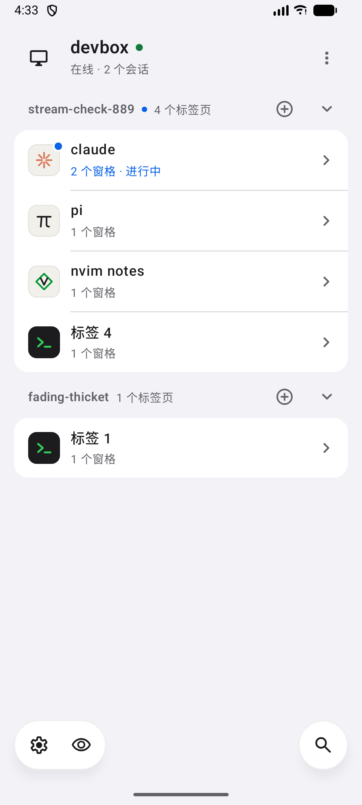
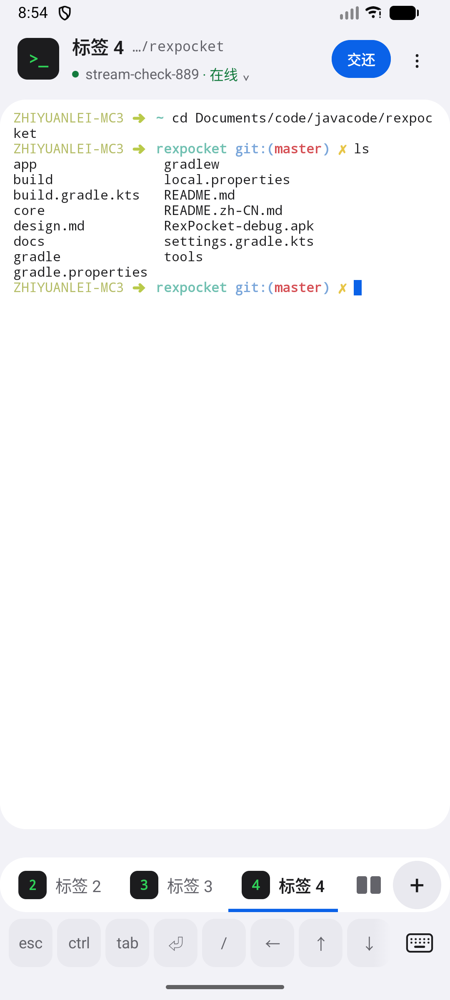
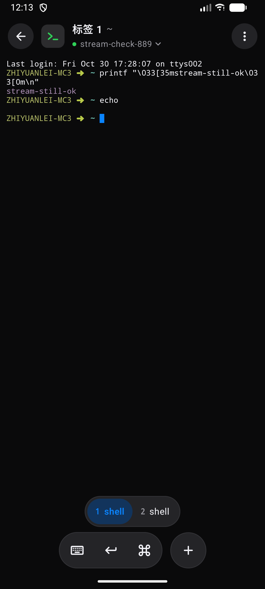

<p align="center">
  <a href="README.md">English</a> · <a href="README.zh-CN.md">简体中文</a> · <b>繁體中文</b>
</p>

# RexPocket

終端機多工器 [Rex](https://rex.app) 的 Android 用戶端。它會把你自己的 Rex 伺服器上的所有工作階段一路列到
分頁，點開任何窗格就是全螢幕終端機，可以直接輸入。它只跟你的 Rex 通訊，不經過任何第三方——可以走區域網路，
也可以透過 App 內建的 Tailscale 節點走你的 tailnet。

| 主頁 | 終端機 | 夜間終端機 |
| --- | --- | --- |
|  |  |  |

## 功能

- **所有主機、工作階段、分頁都在同一頁。** 每個分頁顯示裡面跑的是什麼——pi、Claude、Codex、編輯器
  還是 shell——配上各自的圖示和程式設定的標題；有程式在執行或在等你時，圖示上會有一個藍點。
- **真正的終端機。** 窗格由 Ghostty 的終端機模擬器繪製，資料來自 Rex 自己的串流：先是整個終端機的快照，
  之後是即時輸出。顏色、回捲歷史、全螢幕程式都和桌面上完全相同。
- **為手機而設計。** 輸入直接進窗格。底部浮動的 dock 裡有鍵盤、Enter 和一排快速鍵：`esc`、`C-c`、按住
  會連發的方向鍵、Tab、對下一個鍵生效的 `shift` / `ctrl` / `alt`（快速鍵列和手機鍵盤都適用）、貼上、
  `/` 和複製。按住 `ctrl` 可選 `C-c` `C-d` `C-z` `C-r` `C-l` `C-a` `C-e` `C-w` `C-j`。分割畫面一次顯示
  一個窗格，用下方的切換列在窗格之間切換。
- **連結。** 長按程式輸出的連結（包括程式設定的超連結），可以開啟、複製或分享。
- **檔案和圖片。** 從手機選擇任意檔案，傳送到正在看的窗格。Rex 會把檔案存在電腦上，並自己輸入它的路徑，
  所以截圖可以直接送進 Agent 的提示詞。
- **背景提醒。** 選用：App 在背景時保持連線，程式在等你核准、回答、登入或出錯時發出通知，點通知直接
  開啟那個窗格。
- **和桌面同時使用。** 手機只佔它正在顯示的那個窗格，並以手機尺寸顯示；桌面停在自己的分頁上。
  **交還** 會把窗格還給桌面，直到你再次 **接管**。
- **不裝 Tailscale 也能上 tailnet。** App 內建一個 Tailscale 節點，用 MagicDNS 名稱或 `100.x` 位址
  就能連到主機，也不必佔用手機唯一的 VPN 位置。
- **知道自己舊了。** 每天啟動時（以及點設定 › 更新時）向 GitHub releases 查有沒有新版本，有就提示；
  你不點就不下載，安裝前 Android 只會問一次權限。alpha 版只跟著 alpha 走，正式版只收正式版。
- **淺色與深色** 跟隨手機，介面提供英文與簡體中文。

## 電腦端設定

Rex 必須監聽在手機連得到的地方。

**區域網路。** 用明文連接埠啟動 Rex：

```sh
rex server start --extra-listen :7297 --allow-anonymous
```

能連上這個連接埠的人就能完全控制這個 Rex，所以只在你信任的網路上開啟它。

**tailnet。** 在電腦上開啟 Rex 內建的 Tailscale，它會用自己的 MagicDNS 名稱透過 HTTPS 提供 Rex，
路由器上什麼都不用開。

## 使用方式

1. **新增主機。** 設定 › 新增主機，填名稱和位址就好：
   - `192.0.2.10`——明文，7297 連接埠
   - `192.0.2.10:7300`——換個連接埠
   - `my-mac.tail1234.ts.net` 或 `100.x` 位址——透過 Tailscale，443 連接埠，TLS

   輸入框下面那行會顯示 App 打算怎麼連。
2. **tailnet 主機要先加入 tailnet。** 設定 › Tailscale，給手機一個節點名稱並儲存。App 會開啟一次
   登入頁，之後節點隨 App 啟動。
3. **開啟分頁。** 在主頁點一個分頁。工作階段旁邊的加號會新增分頁，主機的選單可以新增工作階段。
4. **終端機裡：**
   - 點窗格開始輸入。拖曳可回捲，雙指縮放可改字級，長按可選取；長按連結可以開啟它。
   - 指令鍵會開啟快速鍵列。點一下 `shift`、`ctrl` 或 `alt` 對下一個鍵生效，連點兩下則持續開啟：`shift`
     再按 Enter，就是在 agent 的輸入框裡換行。按住 `ctrl` 再滑到想要的組合鍵。
   - 點標題可看目前工作階段的分頁和窗格，以及工作階段清單。
   - 左右滑動，或用窗格下方的切換列，在分割畫面的窗格之間切換。
   - 選單裡有交還 / 接管、分割、重新命名和關閉。
5. **主頁上，** 眼睛按鈕只保留有程式在執行或在等你的分頁；搜尋可以過濾主機、工作階段和分頁。
6. **背景提醒：** 設定 › 背景提醒，並允許通知。監聽期間會有一則靜音通知，點其中的 **停止** 可關閉提醒。
   重新開機後 App 不會自己啟動；Android 的省電策略可能讓提醒延遲。

## 回報問題

App 會把最近幾小時的日誌留在手機上，所以問題發生之後再回報也沒問題。（介面目前提供英文與簡體中文，
下面的按鈕名稱以英文介面為準。）

1. **Settings › Diagnostics。** 行尾顯示 `Off` 時，App 只保留最近幾小時的日誌；顯示 `Recording` 表示
   正在錄製。
2. 問題已經發生過，就點 **Share report**，把檔案附到 issue 裡。只有在操作時才出現的問題，點
   **Start recording**，重現一次，再回來點 **Stop and share**。
3. **Open an issue** 會把同一份報告複製到剪貼簿並開啟 issue 頁面：貼進去，寫一下當時在做什麼，
   如果分享了檔案就一起附上。

報告裡有 App 版本、手機、你的主機、連線做了什麼，以及 App 自己的日誌——最近幾小時的，加上你錄製的那一段。
位址和主機名會替換成 `<hidden>`；分頁標題、窗格裡印出的內容、你輸入的內容都不會出現。它是純文字，
送出前可以先看一眼。

## 運作方式

- **控制連線。** 一條 WebSocket 連 `/api/control`（`rex.control.v1`）。App 訂閱 Rex 的事件，工作階段的
  分頁、每個程式的狀態、標題和 shell 目前目錄都會在變化時推送過來，完全不做輪詢。請求會並行送出；
  鍵盤輸入另外排一個佇列，按下的鍵會照順序送達程式。
- **窗格。** 第二條 WebSocket 連 `/api/data`（`rex.data.terminal.v1`），先傳終端機的 `GHOSTSNP` 快照，
  再傳輸出。串流中斷後會從最後一個位元組續傳；閒置的窗格不產生流量。
- **窗格歸屬。** 手機只用 `session.own_block` 佔住螢幕上的那個窗格，於是 Rex 以手機的尺寸顯示它。
  在分頁和窗格之間切換只發生在手機上，Rex 的目前分頁仍屬於桌面。桌面搶走正在顯示的窗格時，
  手機會再搶回來，桌面堅持得越久，手機就等得越久。交還的窗格一直屬於桌面，直到你接管。
- **Tailscale。** 節點是官方的 `tailscale.com/tsnet` 程式庫，跑在使用者空間，前面是回環位址上的 SOCKS5
  代理，只有 App 自己的連線會走它。節點的 UDP 綁在手機的 Wi-Fi 或行動網路上，在 VPN 允許 App 繞過時會繞開 Clash
  這類代理 VPN，這樣才打得通直連。主頁會顯示到每台 tailnet 主機的路徑——直連、peer relay 還是
  DERP——以及往返延遲，點一下可以重新測量。

### 讓 tailnet 更快

從行動網路連到家中路由器後面的電腦時，Tailscale 常常退回國外的 DERP 中轉，每次往返要幾百毫秒。
要嘛讓電腦能被直接連到（在路由器開 UPnP 或 NAT-PMP，或給它的 Tailscale UDP 連接埠做連接埠轉送），
要嘛在離你近的地方自建 DERP 伺服器或 peer relay 並加進 tailnet。App 不需要任何改動。

## 建置

需要 JDK 17 和 Android SDK（platform 36）。

```sh
./gradlew :core:test :app:assembleDebug
```

APK 在 `app/build/outputs/apk/debug/`；`:app:assembleRelease` 會建置一個以偵錯金鑰簽署的版本。只建置
arm64-v8a。`app/libs/tailnet.aar` 已經放在儲存庫裡，它由 `tailnet/` 這個 Go 模組建置，`tailscale.com` 的
版本由其 `go.mod` 鎖定；要重新建置，執行 [tools/build-tailnet.sh](tools/build-tailnet.sh)。`core` 裡的整合測試會連到 `127.0.0.1:7297` 上的 Rex
（可用 `REX_TEST_HOST` / `REX_TEST_PORT` 修改），沒有 Rex 時會略過。

## 致謝

- [Rex](https://rex.app)，由 [Superlogical](https://superlogical.com) 開發——多工器本身、它的 API
  和工作階段模型。
- [Ghostty](https://ghostty.org)，由 Mitchell Hashimoto 及貢獻者開發，MIT——終端機模擬器：App 建置的是它
  官方的 libghostty-vt，授權見 `app/src/main/assets/licenses/Ghostty-MIT.txt`。
- [Tailscale](https://github.com/tailscale/tailscale)，Tailscale Inc. 及貢獻者，BSD-3-Clause——App 內的
  Tailscale 節點就是它的 tsnet 程式庫。
- [Material Symbols](https://github.com/google/material-design-icons)（Rounded），Google，Apache
  License 2.0——介面圖示。程式圖示是 App 自己畫的，不是各產品的標誌。
